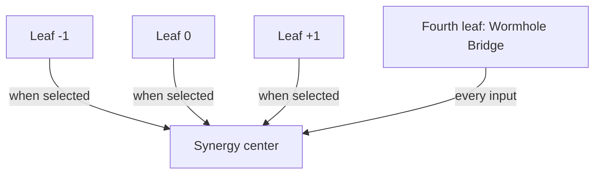

# TriVector Four-Leaf Clover

Design approved by TJ Morris in conversation on October 23, 2026 (America/Chicago).
Scope: a visual and software-design interpretation within Cosmos Expanse.

Four distinct leaves meet at one center. The three routed leaves retain their
individual labels; the existing shared computational path is named the Wormhole
Bridge. Synergy names the combination at the center, not a fifth component.

| Clover position | Software mapping | Current behavior |
| --- | --- | --- |
| Leaf -1 | `experts[0]` | Selected by the router as needed |
| Leaf 0 | `experts[1]` | Selected by the router as needed |
| Leaf +1 | `experts[2]` | Selected by the router as needed |
| Fourth leaf: Wormhole Bridge | `shared` | Contributes to every input row |
| Center: Synergy | Weighted addition before `head` | Combines the shared path and selected expert outputs |

This diagram shows the available connections, not simultaneous activation of all
three routed experts. The implemented default selects two routed leaves per row
and combines them with the shared fourth leaf. The router chooses contributions;
the classification head reads the result. Neither is another clover leaf.

## Algebraic mapping

For input x, let R(x) be the selected expert indices and let their nonnegative
weights sum to one. The implemented combination is:

`center(x) = bridge(x) + sum(w_i(x) * expert_i(x), i in R(x))`

`output(x) = head(center(x))`

The -1, 0 and +1 labels do not set the signs of these weights. The Wormhole Bridge
is the existing shared path: it does not physically connect spacetime or implement
bidirectional messages between experts. No saddle-wave dynamics or quantum
operation is introduced by this naming. Beneficial synergy remains a question for
measurement; the initial sparse prototype scored below the original classifier.

The user approved the clover design. This approval does not assert physical proof,
resolve historical provenance, approve merging, or authorize model publication.
