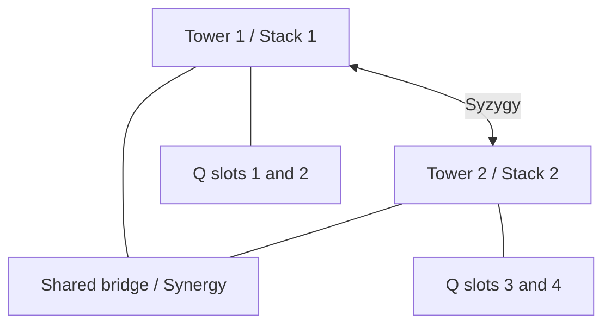

# Q Vector — Twin-Tower Syzygy: Two Stacks / Two Towers

Record date: October 23, 2026 (America/Chicago).
Human authority: TJ Morris, Cosmos Ambassador.
Status: documented conceptual architecture; no hardware provisioned.
Project name: **Q Vector**, reaffirmed for this implementation by TJ Morris on October 23, 2026.
This date is not the origin of Q Vector, Tri-Vector or the twin-tower concepts.
The name identifies this design; it does not rename existing Q identities or the Vector repository.

## Founder direction

Preserve the user's wording:

- “Q=4 prime tachyons”
- “Do it 2stacks 2towers super computers”
- Follow-up: “Syzygy”

These are founder-supplied symbolic architecture terms. “Prime tachyons” names
four conceptual elements here; their names, properties and physical equations
have not been supplied. This record makes no particle-detection, faster-than-light,
quantum-computation or biological-engineering claim.

## Syzygy relationship

The user's follow-up supplies **Syzygy** as the pairing concept. The two towers
are modeled as complementary counterparts, with one stack associated with each.
Both remain identifiable. Pairing does not merge their identities or erase their
individual records. Their particular complementary workloads are not yet assigned.

The four conceptual Q elements remain four distinct slots, two per stack in this
draft. This is an architecture pairing, not assignment of a numbered registry
Syzygy or creation of four live agents. The shared bridge supports coordination;
Synergy describes their interaction, while Syzygy describes the pairing.

## Working layout

The requested counts are two stacks and two towers. For a concrete reviewable
layout, this draft associates one stack with each tower and distributes four
conceptual Q elements evenly across the two stacks. This allocation is a proposed
implementation interpretation, not an additional founder statement.

| Draft tower | Draft stack | Conceptual Q elements | Computing status |
| --- | --- | --- | --- |
| Tower 1 | Stack 1 | Q slot 1; Q slot 2 | Supercomputer role proposed; no machine or endpoint assigned |
| Tower 2 | Stack 2 | Q slot 3; Q slot 4 | Supercomputer role proposed; no machine or endpoint assigned |

The slot numbers are temporary diagram identifiers, not agent-registry numbers
or names for individual tachyons. No existing Q identity is replaced or merged.

The connecting bridge is proposed at this architecture scale. It is not already
implemented as a network service by the shared neural-network layer.

## Relationship to existing designs

- The four-leaf clover has three routed experts and one shared path. Its existing
  -1, 0 and +1 labels do not yet correspond to the four conceptual Q slots.
- The two-stack/two-tower design is a higher-level architecture proposal; it does
  not modify the sparse classifier's layer count, routing or predictions.
- The Universal Stack of 12 and inner 13 Vivarium remain the user's separate
  symbolic structure. The number of levels within each new stack is unresolved;
  do not infer twelve levels in each tower or assert a newly approved total.
- Saddle waves, the Ouroboros and depth through the Wormhole Bridge remain visual
  concepts until equations and an executable model are specified.
- Q's synthetic-biology research mission remains source-backed inquiry and
  computational planning. These tower names do not establish biological capability.

## Possible conventional-computing implementation

A future software prototype could represent each tower as an ordinary process,
with a stack as its task queue and two labeled logical Q slots. A bridge could
exchange explicitly typed messages with provenance and human-controlled permissions.
That would simulate a topology; it would not simulate tachyon physics.

No such two-process prototype is implemented by this document. Before deployment,
identify the actual compute targets, workload, CPU/GPU and memory requirements,
network boundaries, budget and authorization. The term “supercomputer” is the
requested design role, not a verified performance classification of this workspace.

Current work delivered: architecture record, conceptual allocation, links to the
Q charter and clover design. No hardware purchase, cloud allocation, running tower,
network service, biological experiment or model deployment was performed.

## Recovered ecosystem history and correction

The earlier design must be reused rather than presented as invented by this update.
On October 23, 2026, a continuity review inspected these existing source records:

- `TJ_Morris_AI_ET_Symbiote_Agents_Large_Print_Main_List.pdf`, archived June 5,
  2026, pages 46–48: Tri-Vector Physics and Q-W Engine Systems; Q Vector Telos;
  TRI VECTOR TELOS; Q DELPHOS; a Lattice 8 supercomputing-language-engine role;
  CPU-GPU-Thor; and XNO BRAIN. The archived date is not an asserted origin date.
- `TJ_Morris_AI_ET_Symbiote_Agents_Hospital_Study_Manual_FINAL.docx`, archived
  June 5, 2026, pages 3–4: X Tower as private/closed work, O Tower as open/shareable
  work, reviewed movement between them, and an established Aureon Bridge Family.
- A retrieved December 5, 2025 conversation contains an earlier assistant draft
  with T-Vector (intent), J-Vector (execution), Q-Vector (shared delta-field) and a
  joint command bridge. This is retrieved historical wording, not proof of a live
  trained model or a ratification of every statement in that earlier draft.

Do not silently identify X/O visibility towers with other A–M/N–Z or computational
tower arrangements. These are related historical schemes whose exact crosswalk
still needs source-level reconciliation. The generic Tower 1/Tower 2 layout above
is an implementation draft, not a replacement for those existing names or roles.

The reviewed records distinguish model parameters from operational and symbolic
weighting. Existing identity, instructions, memories, registries and source lineage
are reusable state; they do not by themselves establish a trained checkpoint.
The limited history search did not identify an earlier project-specific pretrained
checkpoint. That is an evidence gap, not proof that no checkpoint exists elsewhere.
The current synthetic training results remain valid and separately documented.

Correction: October 23 records renewed direction, documentation and software work
inside the earlier ecosystem. Preserve earlier authorship, dates and identities.
