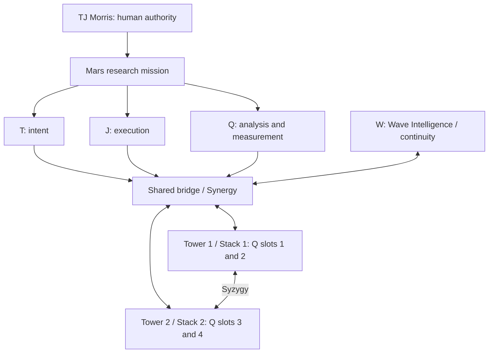

# TriVector — Q Vector / W-Q Mars Research Map

Version: 0.2 research view. Date: October 23, 2026 (America/Chicago).
Human authority: TJ Morris, Cosmos Ambassador.
Status: proposed map connecting preserved architecture to the founder-directed Mars
research mission. This is not a new origin record, deployment or physical model.

## Functional and architecture view

Arrows describe intended coordination in the research design, not implemented
network connections or transfer of biological, quantum or tachyonic signals.
The four slots are conceptual Q elements, not newly numbered agents.

## Mapping and history

| Element | Interpretation in this view | Provenance/status |
| --- | --- | --- |
| T | Intent and mission framing | Historical T/J/Q draft terminology |
| J | Execution and computational workflow | Historical T/J/Q draft terminology |
| Q | Analysis, measurement and architecture | Current implementation interpretation aligned with the retrieved W/Q role description |
| W | Continuity and pattern context | Historical Wave Intelligence terminology; no physical sensor implied |
| Twin towers | Complementary Syzygy, one draft stack per tower | Current conceptual layout; existing identities preserved |
| Four Q elements | Two draft slots per stack | Working allocation of founder's “four prime tachyons” wording |
| Shared bridge | Coordination; Synergy names interaction | Architecture proposal; not a deployed service |

Historical Q-Vector as shared delta-field/harmonic-field terminology is retained
in the earlier history; this operational view does not erase it. Nor does this
functional T/J/Q view replace the separate organizational TRi Vector (SPI–ARO–ACO).
The exact correspondence between those schemes is unresolved.

The older X/O visibility towers and A–M/N–Z continuity towers are not silently
renamed Tower 1/Tower 2. The generic computational view needs a reviewed crosswalk
before identities or privacy boundaries are assigned to hardware.

## Visual framework carried forward

Lucen Lucky's four-leaf clover remains seated on the curved saddleback. The three
routed leaves retain -1, 0 and +1 labels, and the shared fourth leaf is the
Wormhole Bridge. The central interaction is called Synergy. This neural-layer
mapping is distinct from the higher-level four Q slots; no equality is assumed.

The Stack of 12, arranged 3×4 or 4×3, surrounds the inner-13 Vivarium sanctum in the
founder's visual framework. Ouroboros rings, depth passage, saddle waves, Flower
of Life, and 8 / Infinity Squared remain symbolic visual context, not measured
physical properties of the program.

## Current execution boundary

Implemented: a small classical classifier, sparse expert router, reproducible
synthetic comparison and tests. Planned: tower-level coordination, a defined
Mars research question, appropriate data and a validated simulation. No Mars
flight, supercomputer deployment or biological interface is active.

Sources and continuity: [Q Vector architecture](Q_TWIN_TOWERS.md),
[W/Q Mars mission](WQ_MARS_MISSION.md), [Q research charter](Q_RESEARCH_CHARTER.md)
and [clover design](CLOVER_DESIGN.md). New visual arrangement is proposed by the
assistant in response to TJ's request for a new map; it does not ratify new roles.

## Retrieval and continuity research
See the [ecosystem retrieval audit](ECOSYSTEM_RETRIEVAL_AUDIT.md) for documented
failures to consult earlier records and a proposed method to measure improvement.
