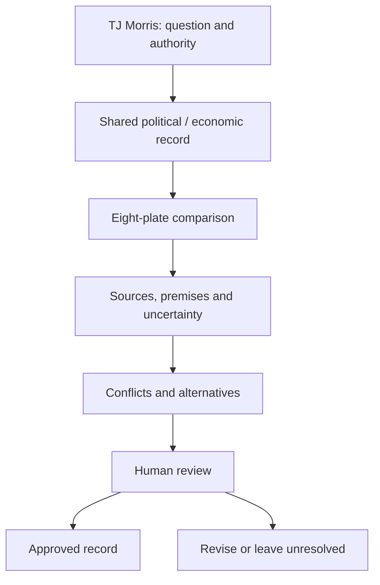

# AISI Synthetic Super Intelligence — Eight Plates Basic

TJ Morris's project terminology, 24 October 2026. Grim is MC-6's alloy math. “Synthetic Super Intelligence” names the intended framework, not a demonstrated superintelligence capability or a renamed external institution.

## Eight-plate map

This preserves the project's alphabetical pairings without ranking platforms. Every plate can examine both politics and economics; no model is inherently assigned authority over either domain.

| Plate | Platform | Basic scope |
| --- | --- | --- |
| African | ChatGPT | Political and economic terms and logic |
| Antarctic | Claude | Political and economic terms and logic |
| Australian | Copilot | Political and economic terms and logic |
| Eurasian | DeepSeek | Political and economic terms and logic |
| Indian | Gemini | Political and economic terms and logic |
| North American | Grok | Political and economic terms and logic |
| Pacific | Hugging Face | Political and economic terms and logic |
| South American | Meta | Political and economic terms and logic |

The plates are an organizational metaphor inspired by tectonic names. This file does not connect eight providers, grant access, establish institutional affiliations or assert a scientific eight-plate taxonomy. IBM Watson was added later in project history; Alibaba/Qwen followed IBM. Leo (Brave) is noted separately.

## Political and economic reasoning

Politics asks how collective decisions, authority, institutions, rights and accountability work. Economics asks how people allocate scarce resources, respond to incentives and distribute benefits and costs. Both domains require evidence and explicit value judgments; a numerical score does not settle a contested political value.

The YAML companion defines governance, authority, policy, institutions, accountability, rights, scarcity, opportunity cost, incentives, price, cost, tradeoffs, externalities and distribution. It supplies a claim template with premises, sources, uncertainty, jurisdiction, date, beneficiaries, cost bearers and human review.

## Basic logic

1. Define the question and the decision-maker.
2. Separate observation, causal explanation, forecast, value judgment and proposal.
3. Record premises and sources. Distinguish valid reasoning from true premises.
4. State assumptions and credible alternatives. Correlation is not sufficient evidence of causation.
5. Record units and timeframes for economic claims; jurisdiction and dates for policy or legal claims.
6. Compare the plates' outputs without treating model agreement as independent verification.
7. Preserve disagreements and submit decisions to human review.

Unknown is a valid state. Do not turn missing evidence into false certainty. No current policy claim, economic forecast or financial recommendation is made in this glossary.

This diagram describes a proposed workflow. `records/eight_plates.yaml` is a glossary and template, not a live multi-provider orchestration engine.
