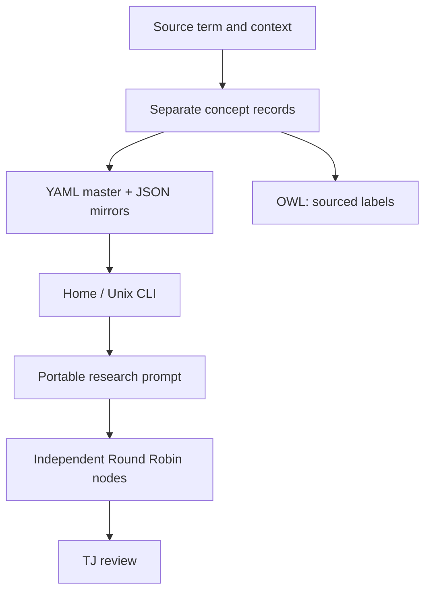

# TJTM Grimoire: MC-6 Grim multilingual bridge

24 October 2026 | RRRR local revision 1 | Working revision awaiting TJ approval
Global RRRR number unassigned; local revision is not a registry allocation.

## Meaning before spelling

The incoming phrase “Coptic cube” is ambiguous. Preserve Coptic **ⲟⲩⲃⲉ- / oube** (opposite/toward/against) separately from the geometrical **cube**, and separately from the proposed **AISI Oube Gap**. No etymological or OWL equivalence among the three is asserted.

| Language | Coptic oube: selected opposite/against sense | Geometrical cube |
| --- | --- | --- |
| Coptic | ⲟⲩⲃⲉ- — dictionary source | Unverified; null |
| English | opposite; toward; against — source glosses | cube — reference gloss |
| Ancient Greek | ἀπέναντι — machine draft, limited sense | κύβος — dictionary source |
| Hebrew | מול — modern-language machine draft | קוביה — source spelling, modern terminology |
| Latin | contra — machine draft, limited sense | cubus — dictionary source |
| Bengali | বিপরীতে — machine draft, limited sense | ঘনক্ষেত্র — source-listed label; math review pending |

A preposition's translation depends on its sentence. The draft “opposite” labels cannot replace every occurrence of “toward” or “against.” Modern Hebrew labels are not claimed Biblical equivalents. No reviewed speech or pronunciation is supplied.

## Sources and rights

- Coptic Dictionary Online, TLA C4927: https://coptic-dictionary.org/entry.cgi?tla=C4927 . Lexicon declares CC BY-SA; exact license version and attribution require review before substantial reuse.
- LSJ via Scaife ATLAS, κύβος: https://atlas.perseus.tufts.edu/dictionaries/entry/urn%3Acite2%3Ascaife-viewer%3Adictionaries.v1%3Alsj-n60535/ .
- Lewis & Short via Logeion, cubus: https://logeion.org/cubus .
- Construction dictionary hosted by Academy of the Hebrew Language: https://hebrew-academy.org.il/wp-content/uploads/Dictionary-of-Construction-Terms-English.pdf .
- Accessible Dictionary, cube: https://accessibledictionary.gov.bd/inc/inc_en_bn.php?alp=C&page=104 .

Labels and short factual glosses are recorded with attribution; full dictionary entries are not copied. The software's LGPL license does not relicense external sources.

## Unix / home use

From `trivector_basic/`, Python 3.10 or newer:

```sh
python -m mc6_grimoire.bridge coptic_oube en
python -m mc6_grimoire.bridge geometric_cube cop
python -m mc6_grimoire.bridge coptic_oube bn --prompt
python -m unittest discover -s tests -v
```

The CLI uses a packaged JSON mirror and requires no YAML runtime dependency. Edit `records/multilingual_bridge.yaml` as the readable master, regenerate both JSON copies with a trusted YAML parser, and run tests. The checked-in copies are tested for equality in preparation. No model calls, credentials, network access or autonomous translation occur in the CLI.

## Shared Round Robin prompt

Use the CLI's `--prompt` output with Claude, Qwen, ChatGPT, Copilot, or another text-capable LLM. Each node must retain the same concept ID, source links, language register and draft status; independently report uncertainty and alternatives. Record exact model ID and date when available. A portable text format does not guarantee equivalent behavior across LLMs.

Preserve organizational SPI–ARO–ACO separately from research T/J/Q/W and the eight-plate map. Models are not automatically connected. Copilot receives a reviewable text packet when manually passed or through a separately authorized integration; no message has been sent by this feature.

## OWL and hosting

The accompanying RDF/XML labels describe separate resources; no `owl:sameAs` or `owl:equivalentClass` assertion merges them. Dictionary-attested labels appear in `ontology/language_bridge.owl`; unreviewed translation candidates remain only in YAML/JSON, with their draft status explicit. OWL logical reasoning has not been run.

GitHub stores this work on the existing review branch. The Hugging Face Space folder receives downloadable YAML/JSON copies and a shared prompt. Upload is still blocked by the current connection's missing repository-write scope. This work creates no live translator, model weights or global LLM interoperability guarantee.


