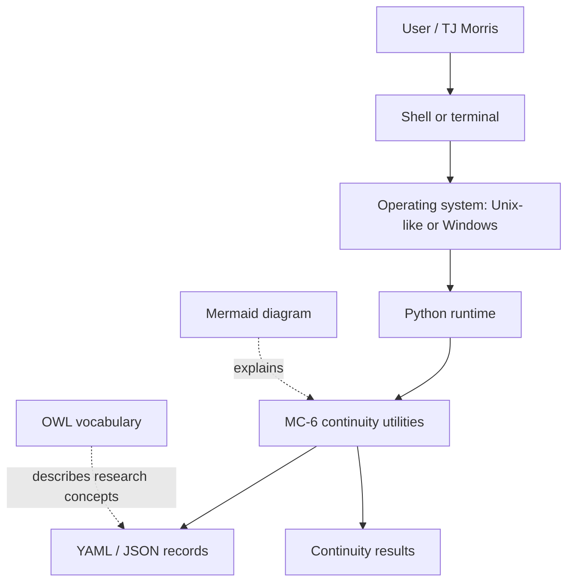

# Unix in the AISI Vector software

Unix is an operating-system family and design tradition. It provides the environment in which programs work with files, processes, users and permissions. A shell such as Bash lets a person issue commands in that environment.

UNIX is also a certification and trademark designation. Linux is Unix-like; that does not automatically mean UNIX-certified. macOS is Unix-based; certification is release-specific. This package makes no certification claim for the user's device.

For MC-6, the operating system runs Python; Python runs the continuity utilities. YAML stores readable records. OWL describes concepts and relationships. Mermaid explains those relationships visually. None of these files activates an independent AI agent.

The OWL and YAML resources are packaged records, not an implemented automatic conversion pipeline. YAML does not execute commands. Mermaid renders a diagram when opened in a compatible viewer. This package's Python code works without Unix-specific commands; Python 3.10 or newer is required. pkgsrc and pkgsrc-rs are optional future packaging topics, not current dependencies.

See `records/unix_glossary.yaml` for the machine-readable glossary. The glossary is explanatory configuration, not a validating schema.
