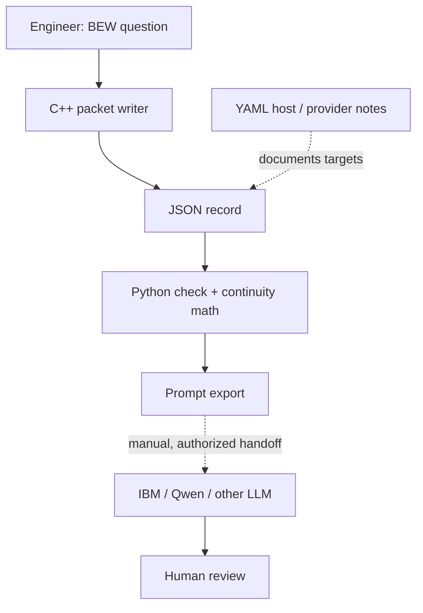

# BEW Basic AI — Engineer Packet

BEW = Basic English Words. Audience: telecom software and field engineers, including AT&T tower engineers. This is an independent AISI package. No AT&T affiliation, equipment access or deployment is asserted.

## What runs

C++ writes a synthetic JSON packet. Python checks it, computes the sample continuity score, and exports an LLM prompt. YAML describes the intended hosts and providers. Mermaid shows the flow. No model is embedded; no tower or provider connection is made.

`[true,false,true]` means two of three checklist items were retained. Output: `L=1/3`, `Q=2/3`, human review pending. These are example checklist results, not tower telemetry or signal quality.

## Unix / Linux / macOS host

From the parent **trivector_basic** directory, with Python 3.10+ and a C++17 compiler:

```sh
c++ -std=c++17 -Wall -Wextra -Werror engineer_basic/cpp/bew_packet.cpp -o /tmp/bew_packet
/tmp/bew_packet unix none > /tmp/bew_packet.json
python -m mc6_grimoire.engineer /tmp/bew_packet.json
python -m unittest discover -s tests -v
```

The compiler and Python must already be present. On systems using `python3`, substitute it for `python`. Host compilation here was tested on Linux; macOS instructions are a porting path, not a tested Apple build.

## Microsoft Windows host

In a Visual Studio Developer PowerShell with C++ tools and Python installed, from **trivector_basic**:

```powershell
cl /std:c++17 /EHsc engineer_basic/cpp/bew_packet.cpp /Fe:bew_packet.exe
.\bew_packet.exe microsoft none | Out-File -Encoding utf8 bew_packet.json
python -m mc6_grimoire.engineer bew_packet.json
```

The Python reader accepts UTF-8 with or without a BOM. Windows compilation was not tested here.

## Apple and Android phones

Both can carry the same UTF-8 JSON/YAML records. This release is source code and a data contract, not an installed mobile app.

| Target | Engineer's next step | Status here |
| --- | --- | --- |
| Apple macOS | Build with a C++17 toolchain; use the host Python CLI | Instructions only |
| Apple iOS / iPadOS | Wrap the C++ core in an Xcode project; review Swift/C++ interop and app file handling | Native app not built |
| Android | Add C++ via Android NDK/CMake; add JNI/UI and file handling in the Android app | Native app not built |
| Microsoft Windows | Build with MSVC C++17 and use Python | Instructions only |
| Unix/Linux | Compile and run the C++ → JSON → Python example | Executed locally |

The C++ executable is a host sample. Mobile integration needs a library interface and app wrapper; the supplied CMake executable target is not an Android JNI library or an iOS framework. Apple/Android platform labels in JSON record the desired host, not a certification or successful native build.

## IBM and Qwen

Run `bew_packet unix ibm` or `bew_packet unix qwen` to tag the requested reviewer. Python exports the same prompt with `connection_status: not_connected`. Copy the prompt into an authorized model interface for a manual test. A live adapter would need a chosen model, endpoint, credentials, input/output format and a recorded test. The project does not assume all providers use the same API.

## Tower-engineer example

Use this example to test data handoff and clear language in an offline training environment. The packet contains no site IDs, credentials, frequencies, power settings, antenna commands or tower location data. It is not a RAN, OSS, RF planning, emergency service or network control application. A real operator deployment needs its own authorized integration, data contract and acceptance checks.

## Packet contract v0.1

| Field | Allowed value |
| --- | --- |
| version | `0.1` |
| language / vocabulary | `en` / `BEW` |
| platform | `unix`, `apple`, `android`, `microsoft` |
| provider | `none`, `ibm`, `qwen` |
| question | Nonblank string, at most 2000 characters |
| evidence_status | `synthetic_example` |
| sources | List of nonblank source strings; empty means no sources supplied |
| continuity | List of booleans; empty produces null L and Q |
| human_review | `pending` |

Unknown or extra fields are rejected. This contract is implemented by the Python checker; it is not a published telecom standard or full JSON Schema validator. It checks structure, not truth. An LLM prompt does not grant permission to act.

## Flow



## Official porting references checked 24 October 2026

- Swift/C++: https://www.swift.org/documentation/cxx-interop/
- Android native code: https://developer.android.com/studio/projects/add-native-code
- Microsoft C++ compiler flags: https://learn.microsoft.com/en-us/cpp/build/reference/compiler-options-listed-alphabetically?view=msvc-170
- IBM Prompt Lab: https://www.ibm.com/docs/en/watsonx/saas?topic=prompts-prompt-lab
- Qwen quickstart: https://qwen.readthedocs.io/en/stable/getting_started/quickstart.html

Sources explain available platform paths; none validates this package on those platforms. Code inherits the parent package LGPL-2.1-only license. RRRR working revision; TJ retains final approval.
